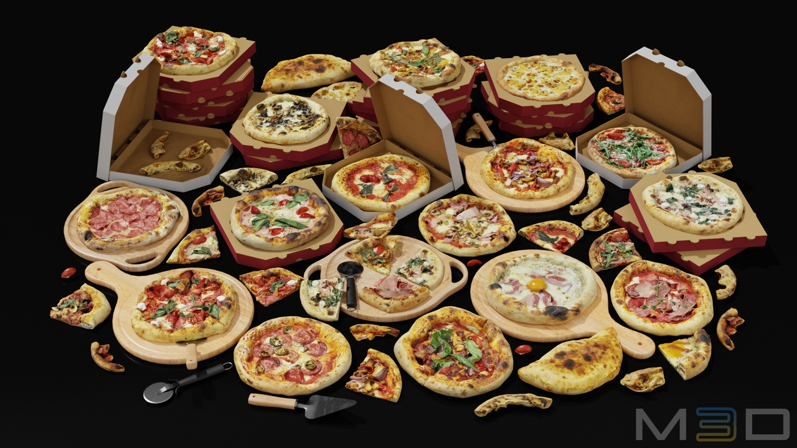
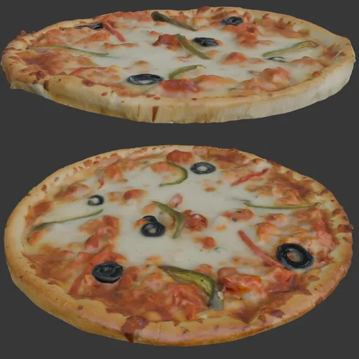
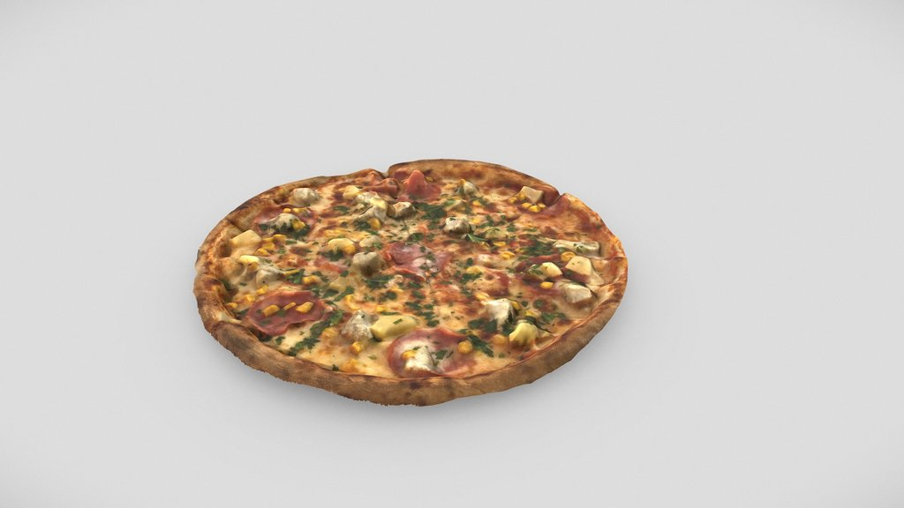
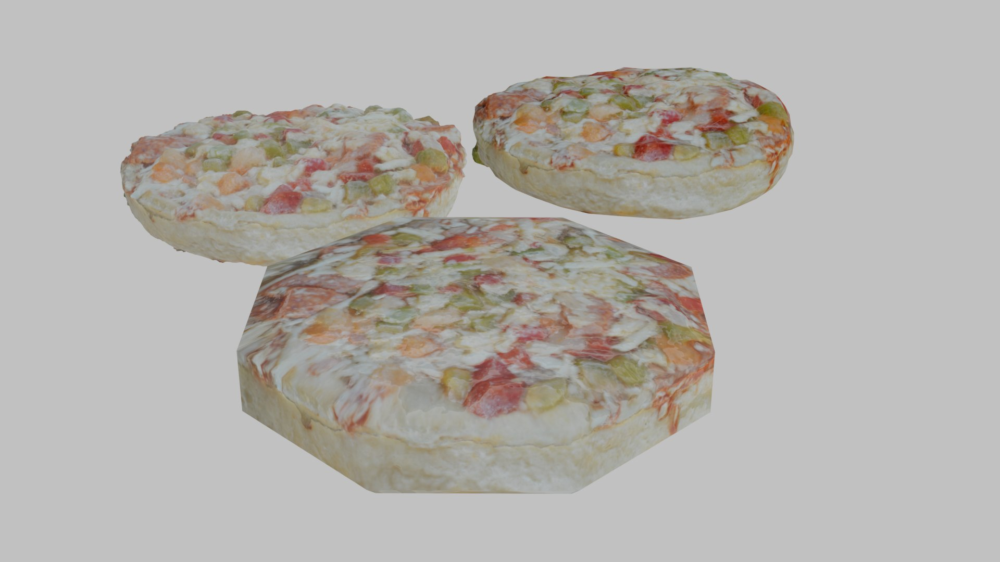
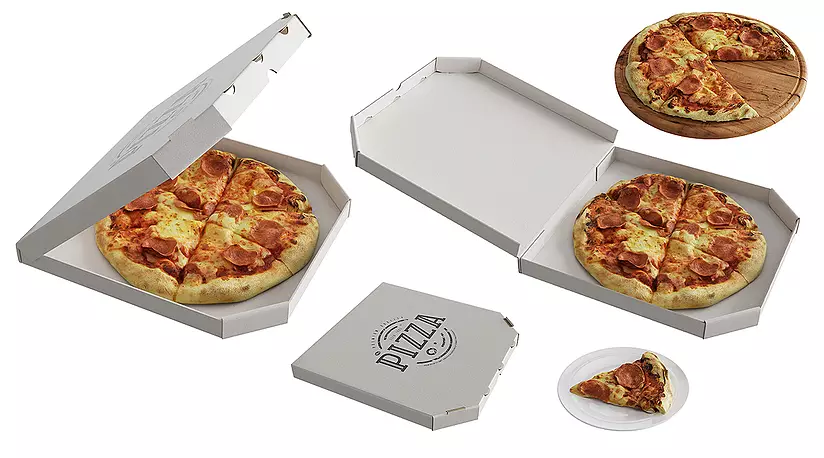

# Pizza asset approval review — 25 November 2026

**Recommendation: qualify the Fab/M3D Scans pack first; do not purchase yet.** Its photographed crust and varied baked surfaces are the strongest match among previews inspected. None of the researched listings proves a complete advertising-quality pizza with independently movable dough, sauce, melted mozzarella, vegetables and herbs. A fused photogrammetry shell is unsuitable for the requested exploded assembly without additional professional asset work.

Six candidates are documented below, including lower-priority options and explicit unknowns. They are research candidates, not six approved production models. Prices are listed currency values retrieved from public pages/metadata, not checkout quotations; taxes, discounts and availability may change. Vendor previews are not Mangosteen dish photographs and must not be used to claim they are.

## 1. Fab — Pizza Pack, M3D Scans

[Product and full visual preview](https://www.fab.com/listings/ce6ebbf1-94f4-4f5c-b3c8-71fa9acf0e7f) · [Local preview](previews/fab.jpg)

- **Price:** Personal ₹2,273.19 sale / ₹3,247.42 regular; Professional ₹4,547.03 sale / ₹6,495.77 regular. Public listing API verified these INR values; 30% sale scheduled through 2 December 2026, 04:59 UTC. Eligibility depends on Fab's licence-tier rules, not whether the project is merely called commercial.
- **Formats:** FBX, OBJ, Blender, Unreal Engine, additional ZIP files listed in public metadata.
- **Textures:** 2K PBR, photoscanned. Sixteen pizza types including Margherita, plus whole/sliced forms, boards and boxes.
- **Licence:** Fab Standard Personal/Professional. See [Fab terms](https://www.fab.com/eula). Commercial incorporation permitted subject to the licence; standalone asset redistribution is not. Confirm public WebGL delivery protection before exporting a publicly retrievable GLB.
- **Visual assessment:** strongest observed irregular crust silhouette and baked variation; preview contains multiple meat pizzas, so select a suitable vegetarian variant rather than misrepresenting menu data.
- **Unverified:** separate ingredient surfaces, complete undersides, Blender shader fidelity and close-up 4K/8K source textures. Whole/slice separation does not establish ingredient separation.

## 2. BlenderKit / Blendkit — Pizza, REAL SCANS

[Product and preview](https://www.blendkit.com/asset-gallery-detail/35f655f4-c568-4c13-bd85-e49547dd38f2/) · [Local preview](previews/blendkit.webp)

- **Price:** free listing. **Format:** Blender-library asset, 20.6 MiB reported; exact downloadable package/extensions require account/add-on inspection.
- **Textures:** resolution not disclosed on this asset page; do not confuse global 8K/16K filter options with this model's specifications.
- **Licence:** Royalty Free, commercial derivative use; [official licence explanation](https://www.blendkit.com/docs/licenses/). Confirm terms for downloadable browser assets before publication.
- **Visual assessment:** plausible cheese/vegetable surface but soft-looking detail in the available preview and a relatively uniform thick crust. Useful no-cost scan qualification candidate, not an approved hero asset.
- **Assembly:** described as a whole-pizza scan. Separate sauce, cheese and toppings not established.

## 3. Sketchfab — Pizza Photogrammetry, alexpremiumgame

[Product / interactive preview](https://sketchfab.com/3d-models/pizza-photogrammetry-7639f6843cf54925a9a5037385ddfeae) · [Local preview](previews/sketchfab.jpg)

- **Price:** free downloadable listing; account may be required. **Geometry:** 178,101 faces from public Sketchfab metadata.
- **Formats / textures:** downloadable archive formats and texture dimensions were not exposed in the accessible public metadata; verify before selection. Do not assume an original BLEND file.
- **Licence:** verified **CC BY 4.0**, permits commercial use with attribution. [Model metadata](https://api.sketchfab.com/v3/models/7639f6843cf54925a9a5037385ddfeae) and [licence](https://creativecommons.org/licenses/by/4.0/). Retain creator, title, source, licence link and modification notice with distribution.
- **Visual assessment:** natural char and organic silhouette; visible scan softness and baked lighting need closer inspection. Topology is not confirmed as separate ingredients.
- **Use:** legally simpler browser-distribution candidate, but visual quality/mesh separation are insufficiently verified. Non-commercial-only Sketchfab pizza scans were excluded.

## 4. TurboSquid — Photogrammetry Frozen Pizza LOD Set, Saripsis

[Product / preview gallery](https://www.turbosquid.com/3d-models/3d-photogrammetry-frozen-pizza-lod-set-2005380) · [Local preview](previews/turbosquid.jpg)

- **Price:** US$79. **Formats:** native Blender 3.6, FBX, OBJ, glTF and STL.
- **Textures:** base-colour/normal textures described; resolution not published in the inspected page. Original scan 690,692 faces; retopology 1,511 faces; low LOD 32 faces.
- **Licence:** listing states Standard Licence. [Official terms](https://www.turbosquid.com/3d-model-license). Confirm permitted browser embedding and protection against standalone extraction before purchase.
- **Visual assessment:** useful technical scan/LOD candidate, but the pale frozen surface is a poor match for the warm baked hero direction. **Not recommended for the hero purchase.** Three LOD meshes are not independent ingredients.

## 5. CGTrader — Photorealistic Pizza Pack: 6 High Quality Pizzas

[Product / visual preview gallery](https://www.cgtrader.com/3d-model-packs/photorealistic-pizza-pack-6-high-quality-pizzas) · [Vendor image](https://img-new.cgtrader.com/items/7436245/52ed02d756/photorealistic-pizza-pack-6-high-quality-pizzas-3d-model-52ed02d756.webp)

- **Price:** US$10. **Formats:** FBX/glTF/STL six of six; BLEND/OBJ/USD five of six, PNG textures.
- **Textures:** one included item advertises an 8K top-down texture; the pack does **not** establish 8K maps on every mesh. UV metadata says unknown.
- **Licence:** Royalty Free (no AI). [CGTrader licence terms](https://www.cgtrader.com/pages/terms-and-conditions), sections 21A/21B.
- **Visual preview limitation:** product gallery exists, but the image CDN returned HTTP 403 for the attempted local download. No local visual qualification is claimed.
- **Assembly:** independent ingredients unverified; advertised realism and low price are not evidence of suitability. Hold until seller supplies wireframe and unlit object-isolation screenshots.

## 6. CGTrader — Pizza BLENDER 3D Model Cycles

[Product / gallery](https://www.cgtrader.com/3d-models/food/miscellaneous/pizza-blender-3d-model-cycles) · [Local preview](previews/cgtrader-cycles.webp)

- **Price:** US$29 appeared in indexed marketplace listing metadata; current checkout price was not exposed on the product page. Treat as indicative only, not an approved budget.
- **Formats:** BLEND, FBX and textures explicitly described. Texture dimensions not disclosed.
- **Licence:** royalty-free marketplace category; verify the exact licence badge/checkout agreement before approval.
- **Visual assessment:** better baked material variation than the frozen model; available preview shows whole pizza, box, board and slice. Native Blender source is a useful production advantage.
- **Assembly:** named objects and correct pivots are advertised, but ingredient separation is not. Pepperoni geometry is not a vegetarian menu substitute. Request a no-meat version and ingredient outliner proof.

## Independent ingredient research

| Asset | Published detail | Production caveat |
|---|---|---|
| [ZB-Vision Mozzarella](https://www.cgtrader.com/3d-models/food/miscellaneous/mozzarella-001) | US$25.25; MAX, FBX, OBJ; 8K base colour/roughness/normal; 1K/29K/470K polygon LODs; Royalty Free (no AI) | Scanned fresh mozzarella, not melted/browned pizza cheese. Corona-only shaders require Blender PBR conversion. Strong ingredient candidate, not a complete cheese layer. |
| [ZB-Vision Tomato](https://www.cgtrader.com/3d-models/food/vegetable/tomato-038) | Scan; 5K/93K/1,491K LODs; 2K/4K/8K maps with 16K base colour advertised | Price/licence and downloadable formats not verified because product-page fetch failed. Whole-tomato scan does not establish sliced interiors. Do not approve purchase yet. |
| [Basil Leaf](https://www.cgtrader.com/3d-models/plant/leaf/basil-leaf) | Dedicated low-poly leaf listing found | Page fetch failed; price, UVs, resolution and commercial licence remain unverified. Research lead only. |
| [Pasta Plate 3D Scene — ingredient donor only](https://www.cgtrader.com/3d-models/food/vegetable/pasta-plate-3d-scene) | Indexed base price US$25, discount unverified; Blender 4.3.2, FBX, OBJ/MTL; named collections include basil, tomatoes, olives and cheese; ~2.19M polygons | Mixed procedural/image materials and cheese particle system. Baking and topology inspection needed. No pasta experience is being built. Exact licence and current sale price still require confirmation. |

The missing critical assets remain **a sculpted/scan-quality baked dough shell, a separate cooked sauce surface, and a genuinely melted mozzarella layer with finished undersides**. Generic mozzarella balls plus a whole-pizza scan do not solve this. If no seller has separated source meshes, commission an artist to adapt a licensed source under a separately approved quote; no commission or message has been sent.

## Purchase qualification checklist

Ask the shortlisted vendor for an exploded viewport capture showing independently hidden dough, sauce, cheese, vegetables and herbs; wireframe close-ups; underside coverage; unlit texture previews; real texture dimensions; original Blender compatibility; total triangle counts; and a clear written answer permitting commercial public Three.js/WebGL delivery. Exporting a raw GLB is not automatically covered by a render licence. CGTrader explicitly requires safeguards against end-user asset extraction. Confirm both model and texture rights.

Also screened: CGTrader's US$69 scanned six-pizza collection (4K maps) has an availability warning in the accessible page; its US$125 “Authentic Italian” pack is labelled AI-generated with a custom licence. Neither is recommended as a shortcut to proven professional separated food assets.

## Outcome

No models purchased, no paid API calls, no uploads, no deployment. Small public vendor previews were saved only for this local approval report; they are not production assets. Fab price/licence and Sketchfab licence metadata snapshots are included. Unknown specifications are left explicit instead of invented. **No candidate currently passes every acceptance criterion.** Approving further qualification is different from approving a final visual asset.
